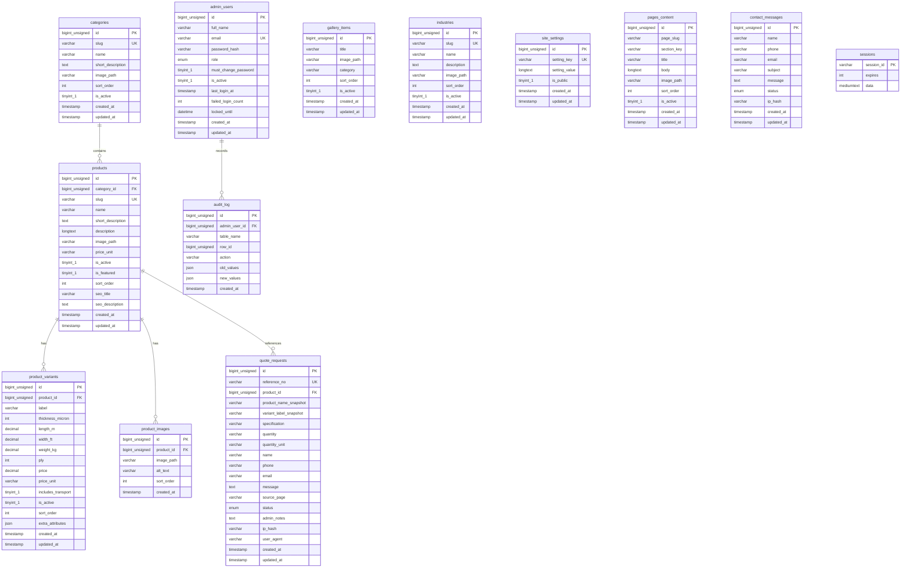

# System Design & Database Architecture

## 1. Architecture Overview

Shivalya Agrotech full-stack architecture is designed for simplicity, performance, and future scalability:
- **Zero-Cloud Dependency**: Runs on a local MySQL 8 database instance with standard connection parameters.
- **Single-Service Deployment**: Node.js + Express acts as both the REST API provider and the static asset server.
- **SQL Source of Truth**: Schema is managed through raw idempotent SQL migrations (`database/000_...` to `database/003_...`).
- **Auditability**: Every administrative mutation (product change, price edit, status update, deletion) is captured in `audit_log`.

---

## 2. Entity-Relationship Diagram (Mermaid)



---

## 3. Database Table Explanations

1. **`categories`**: Groups products into high-level business classifications (`agricultural-films`, `jute-products`, `yarn-textile`).
2. **`products`**: Primary catalog. Contains product names, slugs for SEO URLs, descriptions, primary thumbnail paths, and display toggles (`is_active`, `is_featured`).
3. **`product_variants`**: Specific sellable units or stock keeping units (SKUs) under a product. Allows Mulching Film to carry 5 specific thickness/width/price permutations, and Jute Thread to carry 6, 7, and 8 ply pricing.
4. **`product_images`**: Multi-image support for future carousel or gallery expansion per product.
5. **`gallery_items`**: Visual media items shown on `gallery.html` categorized by tag (`Products`, `Manufacturing`, `Fields`).
6. **`industries`**: Customer sectors served (`farmers`, `nurseries`, `manufacturers`, `textile`), dynamically loaded on `industries.html`.
7. **`site_settings`**: Key-value store for company contact info, GSTIN, phone, address, WhatsApp number, and business hours. Eliminates hardcoded strings in code.
8. **`pages_content`**: Editable content blocks for static informational pages (`about`, `quality`, `infrastructure`).
9. **`quote_requests`**: Stores lead enquiries from home, contact, and product detail pages. Stores snapshots of product/variant names so historical records remain intact even if catalog names change.
10. **`contact_messages`**: Stores inquiries submitted through the contact form.
11. **`admin_users`**: Administrative credentials with bcrypt hashes, role-based access, and brute-force account lockout tracking.
12. **`audit_log`**: Records every create, update, and delete executed through the admin interface with before/after state diffs.
13. **`sessions`**: Server-side session store managed by `express-mysql-session` to ensure authentication persists across server restarts.

---

## 4. How to Safely Edit Data in MySQL Workbench / phpMyAdmin

You can directly modify data using any SQL GUI client without restarting the server:

### A. Editing Prices (Takes Effect Immediately)
Open `product_variants` table:
```sql
-- Update price for 25 micron, 4 ft wide Mulching Film:
UPDATE product_variants 
SET price = 1300.00 
WHERE product_id = (SELECT id FROM products WHERE slug = 'mulching-film')
  AND thickness_micron = 25 
  AND width_ft = 4.00;
```
*Refresh `product.html?id=mulching-film` or `products.html` to see the new price instantly.*

### B. Hiding a Product from the Website
To hide a product temporarily without deleting it:
```sql
UPDATE products SET is_active = 0 WHERE slug = 'yarn-cones';
```
*The product will immediately disappear from the public menu and product listing.*

### C. Updating Contact Information
To update phone number, address, or GSTIN:
```sql
UPDATE site_settings SET setting_value = '+91 99503 37442' WHERE setting_key = 'phone';
UPDATE site_settings SET setting_value = '674, Sector 8, Ambala City, Haryana' WHERE setting_key = 'address';
```

### D. Safe vs. Unsafe Columns Guide

| Table | Safe to Edit Directly | Avoid Editing Directly |
|---|---|---|
| `products` | `name`, `short_description`, `description`, `price_unit`, `is_active`, `is_featured`, `sort_order` | `id`, `slug` (changing slug alters public URLs) |
| `product_variants` | `price`, `thickness_micron`, `length_m`, `width_ft`, `weight_kg`, `ply`, `label`, `is_active` | `id`, `product_id` |
| `site_settings` | `setting_value` | `setting_key` |
| `quote_requests` | `status`, `admin_notes` | `id`, `reference_no`, `ip_hash` |
| `admin_users` | `full_name`, `is_active` | `password_hash` (use admin interface or `scripts/create-admin.js` to hash with bcrypt) |

---

## 5. Security Architecture

1. **Prepared Statements**: All database operations use parameter bindings (`mysql2/promise` with `?` placeholders) to prevent SQL injection.
2. **Session Security**: Session cookies use `httpOnly: true`, `sameSite: 'strict'`, and are stored in the MySQL `sessions` table.
3. **Double-Submit CSRF Protection**: State-changing administrative requests require an `X-CSRF-Token` header matching the signed cookie token.
4. **Brute Force Protection**: Admin login locks accounts for 15 minutes after 5 consecutive failed attempts.
5. **Rate Limiting**: Public quote and contact form submissions are limited to prevent spam. Honeypot traps catch automated bots silently.
6. **Privacy**: User IP addresses are stored exclusively as one-way SHA-256 hashes (`ip_hash`).
